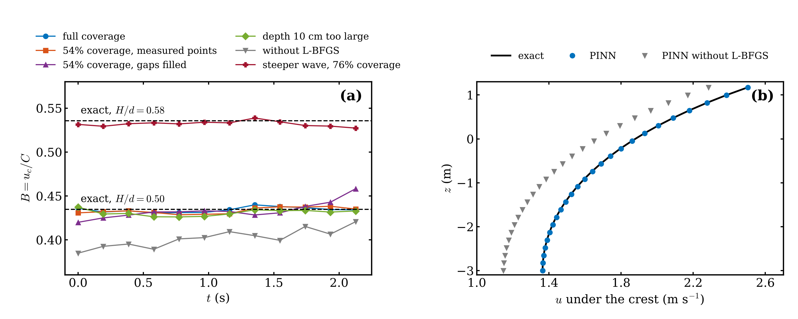

# BreakingPINN

Physics-informed reconstruction of surf-zone crest kinematics from lidar, to test the
breaking-inception threshold **B = u_c / C ≈ 0.85** in a natural surf zone.

For each wave, a potential-flow physics-informed neural network (PINN) reconstructs the free surface
η(x, t) and the velocity potential φ(x, z, t) along a cross-shore lidar transect. It uses the measured
surface profiles and the measured bed. The fluid velocity at the crest, u_c, and the crest speed, C,
then give B(t) up to the observed onset of breaking. The field data are the Duck, NC 2016 lidar and
infrared observations of Carini et al. (shared under CC BY,
[hdl.handle.net/1773/46586](http://hdl.handle.net/1773/46586)).

Work in progress, part of a journal paper in preparation (M. Nouri, University of Delaware).

## Method in brief

- **Equations.** Laplace equation in −h(x) < z < η; nonlinear kinematic and dynamic conditions at
  z = η; no flow through the bed. Two-dimensional, irrotational, inviscid flow.
- **Networks.** Separate tanh MLPs for η(x, t) and φ(x, z, t), with random Fourier features whose
  spread is set per input axis (none in z for φ).
- **Loss.** Each residual is divided by an acceptable error (1 cm for the surface, 2 cm/s for the
  kinematic condition, and so on), so a normalized term of order one means "satisfied to tolerance".
- **Data.** Only real lidar returns are used. Points the gridding filled across gaps are detected
  and dropped (`matlab/carini_gap_study.m`).
- **Training.** (1) η on the data; (2) φ on the physics with η frozen; (3) both together; (4) L-BFGS
  in several rounds, each on a freshly drawn batch.
- **Why stage 4 matters.** Without it the velocity field keeps a spurious uniform current that biases
  B low by 6–11 %. With a single fixed batch, L-BFGS overfits the collocation points.
- **Crest kinematics.** The crest is the highest point of η near the tracked crest. u_c = φ_x there.
  C comes from a straight-line fit to seven consecutive crest positions. Scans near the ends of the
  window, or with a one-sided fit, are flagged.

## Steady-wave benchmark

Against exact steady waves of finite height (Fenton 1988), sampled like the lidar (40-m window,
5-cm grid, 5.17 Hz, 0.3 T, 5 mm noise), B is within 0.001–0.004 of the exact value. This holds for
54–100 % coverage, H/d up to 0.58, and a 10-cm depth error. Details are in `docs/bench_results.md`.



## Layout

| Path | Contents |
|---|---|
| `pinn/pinn_potential.py` | The PINN (PyTorch): `Config`, `fit(...)`, `crest_kinematics(...)` |
| `pinn/run_field_wave.py` | One Duck wave → B(t), B_max, lead time before onset, JSON + figure |
| `pinn/run_batch.py` | Many waves (breakers or non-breaking controls), resumable, writes `summary.csv` |
| `pinn/carini_pinn_load.py` | Reader for the MATLAB export |
| `pinn/fenton_steady.py` | Exact steady waves (Fourier approximation) for the benchmark |
| `pinn/bench_steady.py`, `collect_results.py`, `plot_bench.py` | Steady-wave benchmark and its table and figure |
| `matlab/carini_wave_inventory.m` | Inventory of the waves, breaker classes and records before onset |
| `matlab/carini_export_pinn.m` | Export of the per-wave profiles, depths and crest tracks for the PINN |
| `matlab/carini_gap_study.m` | Lidar return pattern near the crests; mask of gap-filled points |

## Requirements

Python ≥ 3.8 with PyTorch ≥ 1.10, numpy, scipy and matplotlib (`pip install -r requirements.txt`).
A GPU is used when `torch.cuda.is_available()`; this includes AMD GPUs with a ROCm build of PyTorch.
The MATLAB scripts need only base MATLAB.

## Usage

1. Download `lidarIR_sharedData.mat` (and the example record) from the dataset above.
2. In MATLAB, run `carini_wave_inventory.m`, `carini_export_pinn.m` and `carini_gap_study.m`. Together
   they produce `carini_pinn_input.mat` and `carini_pinn_mask.mat`. Keep the two files in one folder.
3. Then, in Python:

```bash
cd pinn
python bench_steady.py --H 1.5 --window 0.3 --gaps 1                    # check the install
python run_field_wave.py ../carini_pinn_input.mat --best plunging        # one wave
python run_batch.py ../carini_pinn_input.mat --set breakers              # all retained breakers
python run_batch.py ../carini_pinn_input.mat --set controls              # steepest non-breaking waves
python run_batch.py ../carini_pinn_input.mat --set breakers --summary-only
```

Each field wave takes about 2.5 min on one GPU. The data and the results are not part of the
repository.

## Status and limitations

- The field results are preliminary. Measured along the transect, B peaks about 0.15–0.2 T before the
  visible onset, below 0.85, in the first waves analysed. The correction for wave obliquity
  (B_transect = B cos²θ) is not yet applied.
- A single-valued η(x, t) cannot follow an overturning front. It can also miss a short, steep front
  that forms ahead of a broad spilling crest. A quality flag for this is planned.
- Potential flow carries only a depth-uniform current, not the sheared undertow of the surf zone.

## License

Code: MIT (see `LICENSE`). Data: Carini et al., CC BY. Cite the dataset if you use it.
